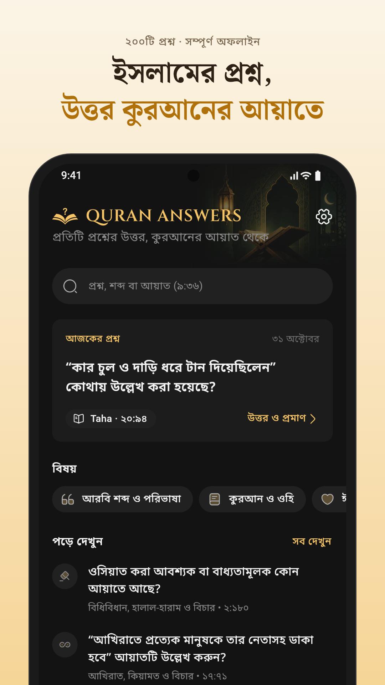
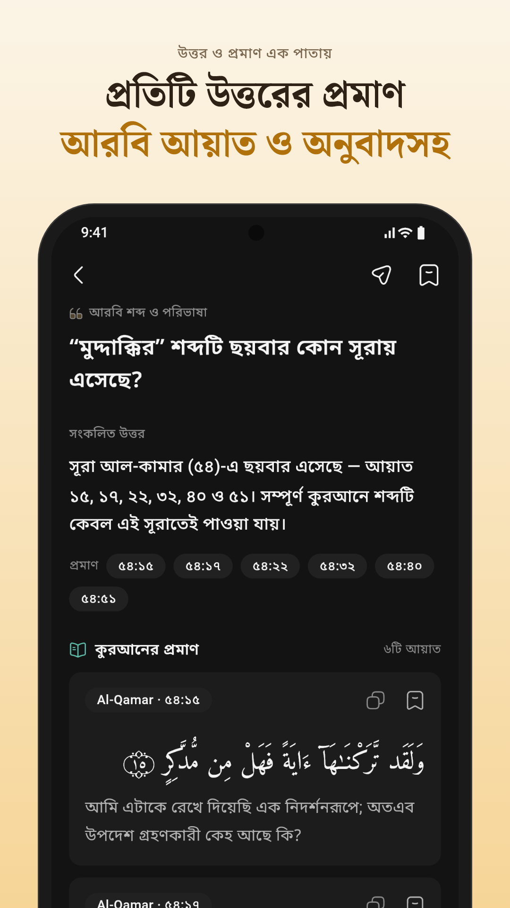
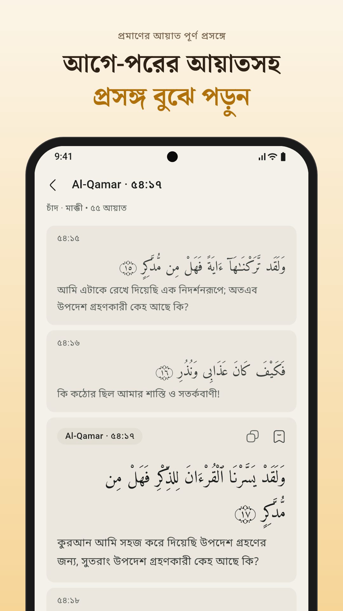
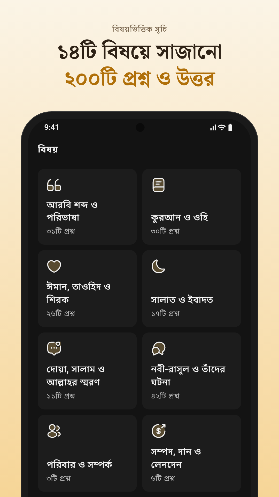

<div align="center">


# Quran Answers

**প্রতিটি প্রশ্নের উত্তর, কুরআনের আয়াত থেকে**

Bengali questions about Islam, each answered only with the ayat of the Qur'an.
Offline, no ads, no tracking.

[](https://github.com/KhalidSaifullahFuad/quran-answers/releases/latest)


[Download](#download) · [Features](#features) · [Screenshots](#screenshots) · [Build](#building-from-source) · [Content](#how-the-content-works)

</div>

---

## About

Quran Answers is a reference app of 200 questions about Islam, written in
Bengali. Every answer is grounded **only** in ayat of the Qur'an: no hadith, no
scholarly opinion, and no AI in the answer path. Each answer shows the Arabic
ayah with its Bengali translation, and any ayah opens in its full surrounding
context so it can be read in place.

## Features

- **200 questions**, browsable by 14 topics, by surah, or as one searchable list
- **Proof on the same page**: Arabic (Uthmani) with Bengali translation for every cited ayah
- **Full mushaf**: all 6,236 ayat; open any ayah with the ayat before and after it
- **Search** in Bengali or Arabic, by words or by reference (`2:255`)
- **Bookmarks** for questions and ayat, organised in folders; reading history you can clear
- **Share** a question with its answer and references
- **Light and dark themes**, adjustable Arabic and Bengali text size
- **Fully offline**: the release build has no internet permission, collects no data and shows no ads

## Screenshots

<p align="center">
  
  
  
  
</p>

## Download

Get the latest APK from [**Releases**](https://github.com/KhalidSaifullahFuad/quran-answers/releases/latest).

| File | For |
|---|---|
| `quran-answers-v1.0.0-arm64-v8a.apk` | Most phones (recommended) |
| `quran-answers-v1.0.0-armeabi-v7a.apk` | Older 32-bit phones |
| `quran-answers-v1.0.0-universal.apk` | Any phone (larger download) |

Verify a download against `SHA256SUMS.txt` in the same release.
Requires Android 7.0 or newer. A Google Play listing is in preparation.

## Building from source

Requirements: Flutter **3.41.9** (Dart 3.11.5), Android SDK, JDK 17.

```bash
git clone https://github.com/KhalidSaifullahFuad/quran-answers.git
cd quran-answers
flutter pub get
flutter run                          # debug build on a device or emulator
flutter test                         # unit and widget tests
flutter build apk --split-per-abi    # release APKs
```

Release builds are signed with the key described in `android/key.properties`
(gitignored). Without that file the build falls back to the debug key.
Play Store steps, listing text and Data safety answers are in
[`store_assets/README.md`](store_assets/README.md).

## How the content works

```
content/quran.json       mushaf + Bengali translation, fetched once at build time
content/questions.json   the questions and answers, authored and reviewed by hand
        │  dart run tool/build_db.dart
        ▼
assets/db/content.db     read-only SQLite (FTS5), shipped inside the app
```

- **Arabic is never typed or pasted.** Answers carry references like `"54:15"`
  only; the Arabic and translation are resolved from the mushaf when the
  database is built.
- `dart run tool/validate_content.dart` checks every reference resolves to a
  real ayah; `build_db.dart` runs the same checks before writing.
- `dart run tool/fetch_quran.dart` refetches the mushaf (only needed to change
  the translation).
- `flutter test tool/render_assets_test.dart` regenerates the launcher icons
  (Android, iOS, web) and the store graphics.

## Tech stack

| | |
|---|---|
| UI | Flutter, Material 3 with a custom design system |
| State | Riverpod |
| Navigation | go_router |
| Storage | Drift + SQLite with FTS5 full-text search |
| Fonts | Noto Sans Bengali, Amiri Quran, Cinzel (all OFL, bundled) |

```
lib/
  core/       database, text normalisation, theme, strings
  features/   one folder per area (home, questions, topics, surahs, ayah,
              search, saved, history, settings, about)
  shared/     widgets used across features
tool/         content pipeline and asset generator
content/      source data for the shipped database
```

## Credits

- Qur'an text and Bengali translation (Sheikh Mujibur Rahman, Darussalaam
  Publication) via the [Quran.com API](https://api-docs.quran.com/).
- Fonts by Google Fonts and the Amiri project, under the SIL Open Font License.

## Contact

Questions, corrections or feedback: open an
[issue](https://github.com/KhalidSaifullahFuad/quran-answers/issues) or email
the address in [`store_assets/privacy-policy.md`](store_assets/privacy-policy.md).
